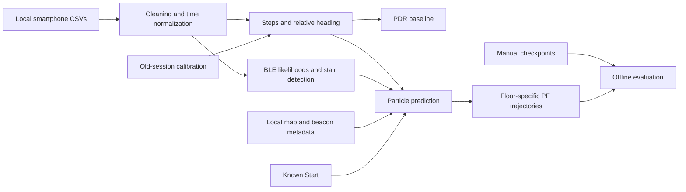

# EMI Indoor Localization

An offline indoor-localization experiment that combines smartphone inertial
measurements, Bluetooth Low Energy (BLE) RSSI, and building geometry in a particle
filter. The Group E Embedded Intelligence coursework project reconstructs
pedestrian routes across two floors and compares them with manually timed
checkpoints.

The main entry point is [Indoor_Localization_Report.ipynb](Indoor_Localization_Report.ipynb).
It contains the complete pipeline; there is no web application, mobile recorder,
or separately packaged Python API in this snapshot.

The stack is Python/Jupyter with NumPy for numerical operations, pandas for
sensor tables, Matplotlib for plots and animation, and scikit-learn for Ridge
and logistic regression. Experiments use recorded smartphone IMU measurements,
two BLE beacons and two floor plans; execution requires no external service.

## Implemented Workflow

- Clean and separate timestamped accelerometer, gyro, orientation and BLE events.
- Detect walking events and build a pedestrian dead-reckoning (PDR) baseline.
- Fuse relative yaw with timestamp-integrated gyro for heading changes.
- Blend a physical Weinberg step-length model with Ridge regression trained on
  an earlier session; retain logistic turn probability as a diagnostic.
- Track 1,000 particles with BLE log-distance likelihoods, walkable-area
  constraints, and effective-sample-size resampling.
- Infer stair transitions from recorded IMU/BLE features and transfer the cloud
  between floor-map stair regions.
- Produce floor-specific trajectories, checkpoint errors, sensor plots and
  optional particle-cloud animations.

These are offline recording workflows. Full-recording feature fitting and
future-sample windows mean the notebook is not a verified real-time tracker.

## Architecture



[Architecture](docs/ARCHITECTURE.md) describes the interfaces, coordinate
conversion, timing conventions and evaluation assumptions.

## Getting Started

Use Python 3.13 for the documented validation environment. Python 3.14 is not
validated. Run commands from this repository's root:

```bash
python -m venv .venv
```

Activate with `.venv\Scripts\Activate.ps1` in PowerShell or
`source .venv/bin/activate` in a POSIX shell, then:

```bash
python -m pip install -r requirements.txt
python -m ipykernel install --user --name emi-indoor-localization --display-name "EMI Indoor Localization"
python -m jupyter notebook
```

Before execution, supply the authorized recordings, metadata, floor maps and
optional calibration table as described in [Data](docs/DATA.md). They are not
distributed here because publication rights were not established in the source
workspace. An empty checkout supports code review, but cannot reproduce the
experiment until these inputs are supplied.

Open the notebook, select **EMI Indoor Localization**, and restart the kernel
and run all cells. For batch execution:

```bash
python -m jupyter nbconvert --to notebook --execute Indoor_Localization_Report.ipynb --output Indoor_Localization_Report_Executed.ipynb --ExecutePreprocessor.kernel_name=emi-indoor-localization --ExecutePreprocessor.timeout=1200
```

Generated CSVs and particle clouds are written to `data/processed/R1/` through
`R4/`; plots appear in notebook outputs. MP4/HTML animations are disabled by
default. [Setup](docs/SETUP.md) covers versions, working-directory requirements
and troubleshooting.

## Validation and Results

A documented verification run on 23 October 2026 executed the unchanged code
against the four configured July 18–19 recordings in an isolated environment. All ten code
cells completed. With seed 42, the pooled mean error is **2.630 m over 22
checkpoints**, or **3.024 m over 18 checkpoints excluding known Starts**. The
[experiment record](docs/EXPERIMENTS.md) records the result and its provenance.
Checkpoint error is not continuous ground-truth trajectory error; the default
summary includes known Starts and skips references without an estimated floor.

No automated regression-test suite is included. The recorded verification
checked notebook structure, unchanged code cells, local documentation links,
dependency imports, execution results and distribution exclusions. It does not
establish performance on unseen participants or buildings.

## Repository Structure

```text
.
|-- Indoor_Localization_Report.ipynb  # Full implementation; outputs cleared
|-- requirements.txt                # Runtime dependency bounds
|-- CONTRIBUTORS.md                 # Group attribution and research sources
|-- data/README.md                  # Required local input layout
`-- docs/
    |-- ARCHITECTURE.md              # Algorithm and data flow
    |-- SETUP.md                     # Installation and execution
    |-- DATA.md                      # Schemas, provenance and rights
    |-- EXPERIMENTS.md               # Verified evidence and metric limits
```

## Known Limitations

- The dataset contains four routes in one building, with manually timed sparse
  checkpoints and one intended floor transition.
- The initial position and floor are known. This is not evidence of reliable
  global localization from an unknown start.
- The PF uses separate horizontal and vertical map scales embedded in code;
  scalar map-configuration values disagree with this conversion.
- Map tests check particle endpoints, not the swept motion through walls.
- Floor-conditioned nearest-time checkpoint matching can use future estimates,
  select distant times and omit missing-floor checkpoints.
- Historical device notes, recording metadata and saved notebook outputs are
  inconsistent. [Experiments](docs/EXPERIMENTS.md) identifies which source and
  inputs produced the reported results.
- Five-seed performance values in the old README lack a matching captured
  experiment in this snapshot and are not presented as verified benchmarks.

## Contributors, Sources and License

This is collaborative Group E work by Arpitha Thimmegowda, Darshan Morkar and
Venkata Kishore Dannana. See [Contributors](CONTRIBUTORS.md) for attribution and
the three scientific sources retained from the project.

**License and data availability:** EMI is a collaborative academic project. No open-source license has been assigned. Please contact the project contributors about permission to reuse or redistribute the code. Sensor recordings, floor plans, beacon metadata and calibration data are not included because their distribution rights have not been established. Third-party libraries retain their respective licenses.
